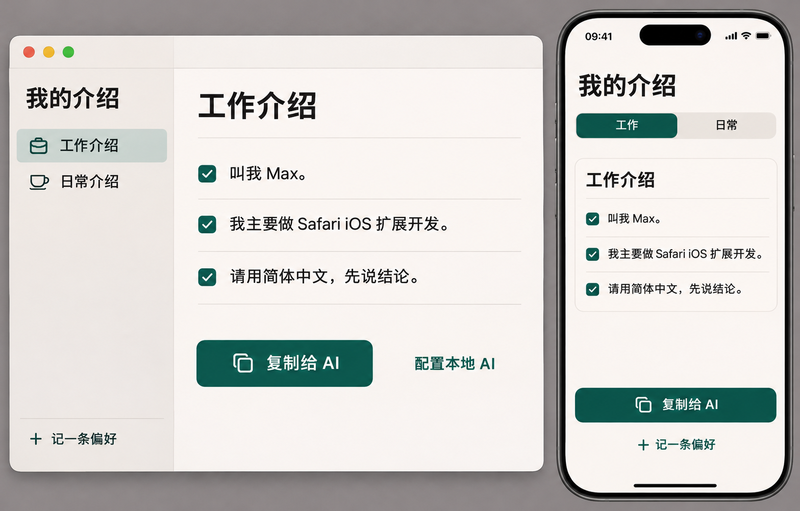
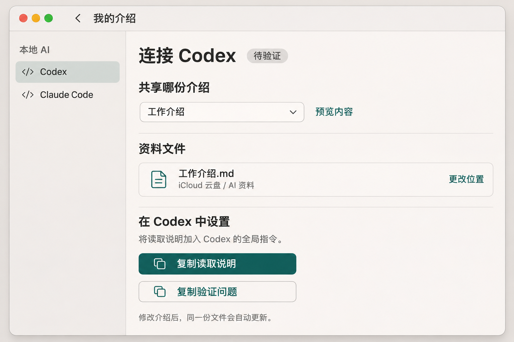

# MeBrief（识我）· 第一版产品规划书

| 项目 | 内容 |
| --- | --- |
| 英文名 | MeBrief |
| 中文名 | 识我 |
| 项目仓库 | [wangzhichuang/MeBrief](https://github.com/wangzhichuang/MeBrief) |
| 规划版本 | V1.1，2026-11-27（补充 iCloud 云盘同步与真机验收） |
| 需求方 | 王志闯（CPM_Max），个人项目 |
| 目标平台 | macOS、iOS，按 Mac App Store 与 iPhone App Store 分发设计 |
| 当前阶段 | 产品规划定稿，附两张概念稿；开发、真机验证与商店审核在后续阶段进行 |

## 产品目标

经常切换 AI 的人会反复交代同几件事：怎么称呼自己、平时做什么、喜欢怎样的回答。用户希望在 Mac 和 iPhone 上维护同一份资料，开始一段新对话时，只给 AI 这次用得上的背景。

**首页优先解决“我已经写过，拿来就用”。** 例如，“请用简体中文”可同时用于工作和日常，“排查问题时区分实测和推断”只用于工作。用户改一次措辞，所有引用它的介绍随之更新。偶尔从对话里发现新偏好时，可以手动记一条。从整段聊天自动提取偏好留作后续迭代。

## 首页「我的介绍」与日常使用

| 用户动作 | Mac | iPhone |
| --- | --- | --- |
| 打开 App | 左侧选择「工作介绍」或「日常介绍」，右侧预览正文 | 顶部切换「工作／日常」，下方直接显示介绍 |
| 把介绍给 AI | 点「复制给 AI」，粘贴到目标工具；常用工具还可点「连接本地 AI」 | 底部点「复制给 AI」，切到任一聊天 App 粘贴 |
| 这次少带一句 | 在预览里临时取消勾选，再复制 | 同 Mac，复制前所见即所得 |
| 补充一条新偏好 | 左侧底部点「记一条偏好」 | 主按钮下方点「记一条偏好」 |

每台设备记住上次使用的场景。有资料时，打开首页就能复制。首次使用时引导用户写下第一条信息，并选择适用场景。图中的姓名和职业仅用于演示，新用户从自己的资料开始。

**资料维护与临时勾选。** 新增、编辑或删除一条资料，会更新它所属的介绍；从某个场景移除，只影响该场景。首页勾选用于本次复制，复制后恢复该场景的默认内容。长期提供给本地 AI 的文件始终采用场景中已保存的条目。「复制给 AI」只在选中至少一条时可用，成功后显示「已复制」。

## Mac 连接本地 AI

首批适配对象为 **Codex 和 Claude Code**。两者分别提供设置说明，发布前分别实测。用户只需为每个工具配置一次。

1. **选工具和场景。** 从首页进入「连接本地 AI」，选择工具和介绍，点「预览内容」核对这个工具将能读取的全文。
2. **选文件位置。** 通过 macOS 文件选择器选定资料位置。跨设备使用时选择 iCloud 云盘，使用两端约定的「MeBrief」资料文件夹。界面显示文件名、位置和「更改位置」入口。
3. **复制读取说明。** App 将实际文件路径填入相应工具的说明。用户把说明追加到工具的全局指令中。说明示例为“新对话开始时，请先读取指定位置的《工作介绍》，并按其中的偏好与我协作”。操作完成后显示「待验证」。
4. **在新聊天中核对。** 用户点击「复制验证问题」，让目标 AI 从文件中读出当前版本标记和一条偏好。两项均与预览一致后，用户手动标记「你已验证」。该状态记录这次核对结果。
5. **继续使用。** 修改资料后，同一路径上的介绍及版本标记更新。移动文件或改用另一份介绍时，界面提示重新复制读取说明并验证。工具缺少读取权限时，保留「待验证」，用户仍可回首页复制介绍。

## 双端同步与隐私

**同步前提。** Mac 和 iPhone 登录同一 Apple 账户并开启 iCloud 云盘。两端使用云盘中同一个 MeBrief 资料文件夹，首次设置时显示实际位置。MeBrief 无需额外账户或业务服务器。[Apple 的 iCloud 云盘设置说明](https://support.apple.com/zh-cn/118443)

**保存与读取。** 新增、编辑、删除资料或调整场景时，当前设备先保存条目，再在同一次保存流程中更新受影响的 `工作介绍.md` 和／或 `日常介绍.md`。文件包含当前场景的完整内容和可核对的版本标记。仅修改工作条目时，日常文件内容与版本保持原值。iCloud 上传后由另一设备接收；Mac 版 MeBrief 退出时，系统仍可同步手机已生成的 Markdown。AI 下一次读取这个固定路径即可获得本机已下载的版本。首页临时勾选与复制只改变本次剪贴板内容。

| 可观察到的事实 | 用户看到的状态 |
| --- | --- |
| 已写入本机，离线或系统仍在等待上传 | 已保存到本机，等待上传；可继续编辑和复制已下载的资料 |
| 系统确认相关文件上传成功 | 已上传到 iCloud |
| Mac 已取得新版文件 | 显示本机文件的实际版本；手机端只报告自己可确认的状态 |
| 用户曾在 AI 新聊天核对版本 | 单列“上次由你验证的版本”，保留当时的版本标记 |

iCloud 未开启、空间不足或文件访问失败时，提示实际原因及重新选择资料位置或重试的入口。上传和下载用时取决于系统和网络。[Apple 的云盘文件状态说明](https://support.apple.com/zh-cn/guide/mac-help/mchlc994344b/27/mac/27)

- 资料由用户在设备和自己的 iCloud 云盘管理。粘贴给哪个 AI、允许本地工具读取哪份介绍，均由用户决定。首版使用手动录入和文件读取，无需第三方模型 API。产品仓库只保存规划、示例和代码，真实用户资料由 App 单独保存。

## 上架与验收

首版交付的是可持续维护、按场景分享的个人资料工具。提交审核时用虚构示例演示新增、跨场景复用、一次性勾选和跨端更新；Mac 版通过系统文件选择器取得用户授权。隐私政策与商店隐私信息按实际实现填写。选定首发地区后再核对当地材料，中国大陆商店需核对适用的备案要求。最终上架结果以 Apple 审核为准。[Apple 审核指南](https://developer.apple.com/cn/app-store/review/guidelines/) · [地区合规信息](https://developer.apple.com/cn/help/app-store-connect/reference/app-information/app-and-compliance-information/)

| 验收场景 | 通过条件 |
| --- | --- |
| 第一次打开 | 可从空状态创建自己的第一条资料，并在所选场景中复制 |
| 同一句话用于两个场景 | 只编辑一次，两份介绍均显示新措辞；只从工作场景移除时，日常介绍仍保留 |
| 临时少带一条 | 剪贴板只含勾选内容，下一次介绍仍完整，供本地 AI 读取的文件也保持完整 |
| iPhone 改、Mac 用 | 在同一 Apple 账户的真实设备上修改，完成同步后两端显示相同内容，Mac 文件版本随之更新 |
| Codex、Claude Code 分别连接 | 每个工具均在新聊天中读出正确文件版本与偏好；单纯复制指令不会产生已验证状态 |
| 文件移动或访问受限 | 用户能看到需要采取的动作，修正位置后可重新验证；复制介绍仍可使用 |

### iCloud 真机验收步骤

**设备与记录。** 使用一台 Mac 和一部真实 iPhone，安装同一测试版本并按上述前提设置。使用虚构偏好，记录设备系统、构建号、文件版本和实际观察结果。以下为待执行用例。

1. **建立基线。** 在两端打开同一资料文件夹，准备工作和日常各一条介绍。记录两份文件的版本，并在 Mac 配置 Codex、Claude Code 读取工作文件，分别用新聊天核对基线。
2. **退出 Mac App。** 完全退出 Mac 上的 MeBrief，保持 Mac 联网。在 iPhone 新增仅用于工作的偏好，写入当次独有的测试短语。保存后记下新工作版本，观察上传状态。
3. **在 Mac 核对落盘。** 等待访达中的工作文件下载完成，全程保持 Mac 版 MeBrief 退出。检查工作文件出现测试短语且版本与手机相同；日常文件的版本和正文均与基线一致。
4. **验证 AI 真实读取。** 分别使用 Codex、Claude Code 的新聊天，让它们从已配置的文件读出当前版本和测试短语。验证问题本身不含预期答案。两个工具分别记录结果；随后打开 Mac App，核对首页与文件一致。
5. **验证单次复制隔离。** 在 iPhone 临时取消勾选测试短语并复制。剪贴板不包含该句；两端工作文件仍包含该句且版本保持原值。
6. **验证离线恢复与反向同步。** iPhone 离线时编辑已下载的资料，确认本机可复制新内容，Mac 仍看到旧版本。手机恢复网络后，重复文件与 AI 核对；最后在 Mac 编辑日常介绍，在 iPhone 核对新正文与版本。

## 迭代顺序

1. **先跑通双端核心体验。** 完成资料维护、两个场景、一次性勾选、复制和 iCloud 同步。
2. **再验证 Mac 本地连接。** 用 Codex 和 Claude Code 分别走完首次配置、修改后读取和文件移动三个场景。
3. **达到验收条件后准备上架。** 用真机复核双端体验，再准备隐私政策、商店截图与审核说明。首发地区、定价和发布日期在提审前决定。

后续优先观察一个问题：用户是否经常在纠正 AI 后想把那句话留下来？如果手动记录仍有明显负担，再设计“从对话提取偏好，由用户勾选保存”。
